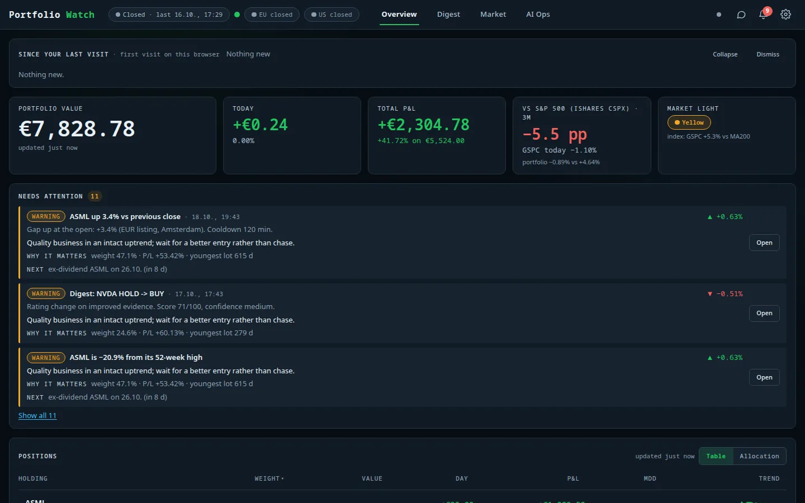
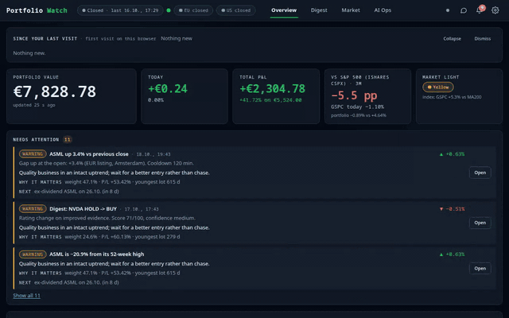
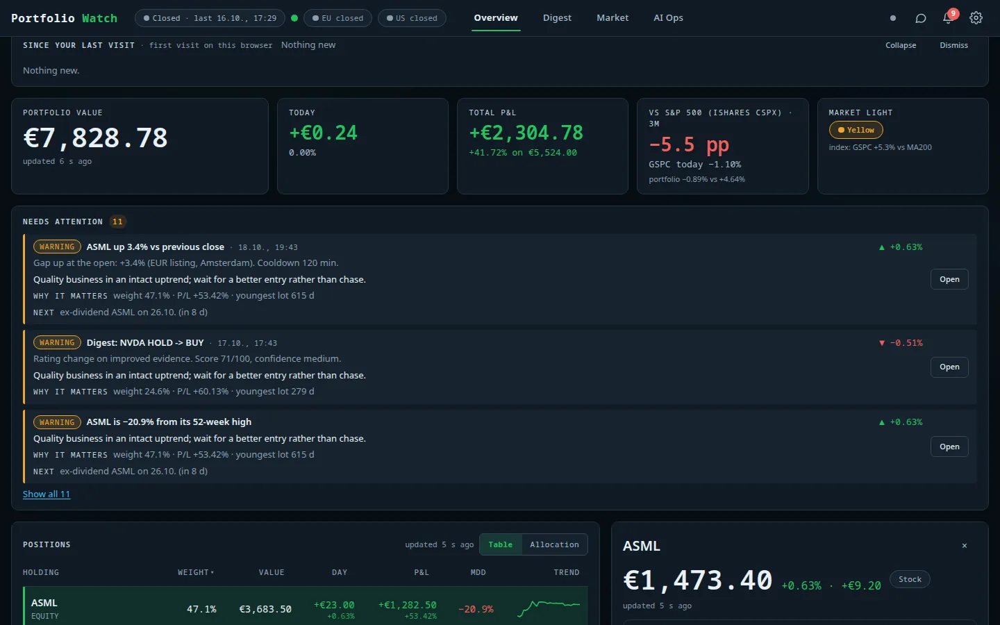
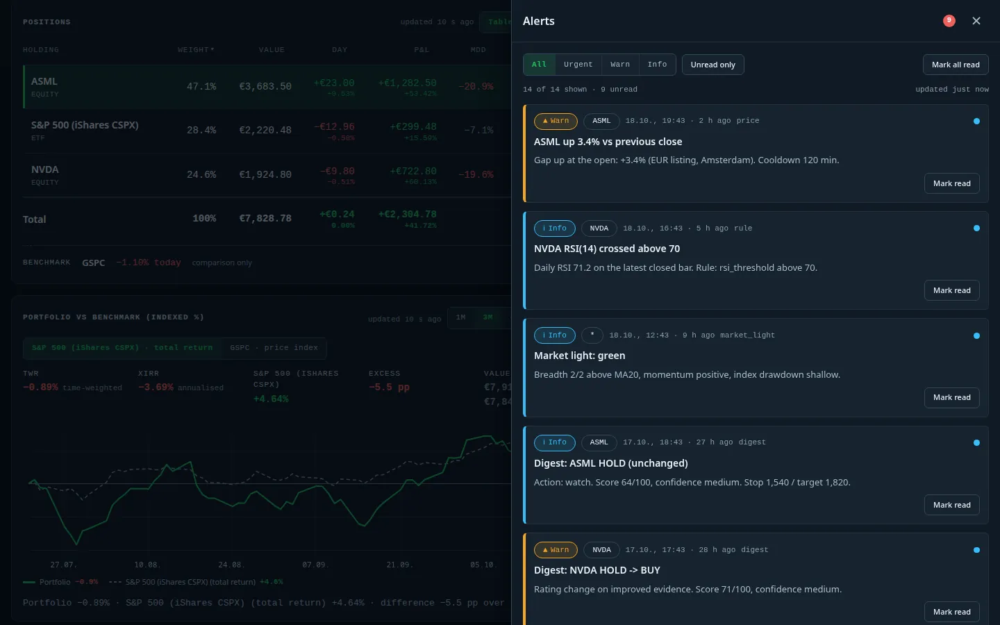
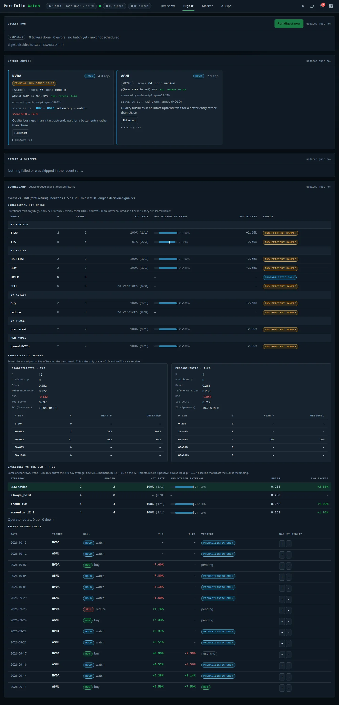

# Portfolio Dashboard

A single-user, LAN-only dashboard for a small EUR portfolio: live valuation, benchmark comparison,
alerts and push notifications, and a local-LLM analysis/digest pipeline running on shared GPU lanes.
FastAPI backend, vanilla ES-module frontend (no build step), deployed as a **rootless podman quadlet**
on Bazzite (Fedora Atomic) with an RTX 5090.

- UI: `http://<host>:8601` (HTTP Basic auth; `/health` is the only open route besides ntfy approval callbacks)
- Example setup: EU-listed holdings (ASML `ASML.AS`, NVDA `NVD.DE`, iShares Core S&P 500 UCITS ETF
  `SXR8.DE`) valued in **EUR**; the S&P 500 index (`^GSPC`) is a **benchmark only**. Everything is configurable.
- Agent/maintainer docs: [`AGENTS.md`](AGENTS.md) and [`skills/`](skills/).
- **Documentation with screenshots and a walkthrough video: [`docs/`](docs/README.md).**



<p align="center">
  <br>
  <sub>first 26 s · <a href="docs/media/video/walkthrough.mp4">full 65 s video (mp4)</a> also covers the alert center, the digest with the v3 scoreboard, the market view with the events calendar, AI Ops and settings</sub>
</p>

| Holding detail | Alert center | Digest and scoreboard |
|---|---|---|
| [](docs/features/holding-detail.md) | [](docs/features/alerts.md) | [](docs/features/digest-and-scoreboard.md) |

*All media come from a demo instance with fictional positions – see [`docs/demo-data.md`](docs/demo-data.md).
More: [overview](docs/features/overview.md) · [analysis and reports](docs/features/analysis-and-reports.md) ·
[market](docs/features/market.md) · [AI Ops](docs/features/ai-ops.md) · [settings](docs/features/settings.md) ·
[mobile and themes](docs/features/mobile-and-themes.md).*


## What it does
| Area | Details |
|---|---|
| **Valuation** | `shares × EUR listing price`; day P/L, total P/L against EUR cost basis, weights, max drawdown; positions without a known cost basis are valued but excluded from P/L and flagged. |
| **Ledger and performance** | Optional dated buy/sell **lots** per holding (FIFO cost, fees included): when present, `shares` and `investedAmount` are derived from them. Gives time-weighted return (**TWR**) and money-weighted **XIRR**, history `basis` (`lots` vs `current_shares`), EUR-vs-local-vs-FX **attribution**, and a **risk** view (direct and look-through exposure, currency exposure, volatility, beta, drawdown, correlation, concentration). Ranges 1M / 3M / 6M / 1Y / **ALL**. |
| **Benchmark** | Portfolio vs S&P 500 (index converted to EUR with daily FX, because the ETF is unhedged), indexed to 0 % over 1M/3M/6M/1Y/ALL. The **performance benchmark** (`performanceBenchmark`, e.g. `SXR8`) is the total-return comparison used for excess return, the advice probabilities and the scoreboard. |
| **Prices and calendars** | One authoritative series per holding (the EUR listing via Yahoo). US live feeds (Twelve Data / Finnhub WebSocket) are shown only as a labelled `usLive` reference. Sessions, holidays and early closes come from `exchange_calendars` (XAMS, XETR, XNYS, ...; `.DE` listings are XETR). `prevClose` is the close of the previous *session* (see below). |
| **Alerts** | **σ-scaled** session-move and opening-gap alerts (rules v3), user rules (EMA cross, RSI, volume spike, absolute level, earnings lead, short-ratio spike, market-light drop), news alerts with LLM triage, SEC Form 4 / 8-K insider alerts, and a daily policy watcher (drift bands, single-stock cap, monthly trend flips). |
| **Notifications** | ntfy with a durable outbox (retry/backoff), severity filter, global **quiet hours**, **per-source daily caps**, a separate **ops topic** for infrastructure alerts, per-alert deep links (`#alerts/<id>`), dedupe; an in-app **alert center** with unread count and ack. Approval buttons use per-approval HMAC tokens. |
| **AI analysis** | In-process pipeline (analyst → research → trader → risk → PM) producing a structured decision (rating, action, score, confidence, battle plan, plus `p_outperform_20d` and `expected_excess_20d_pct`). Quick / standard / deep modes; evidence pack where every field carries `as_of + source` or the literal `MISSING`, including `portfolio_context` and `policy_context`. |
| **Digest** | Twice-daily consolidated push per batch, **trading days only**; rating changes use hysteresis (confirmed on repeat or a strong band move); draft lanes never publish; only confirmed changes are pushed (priority 3 or 4, never 5); event-driven deep runs (earnings, new filing, triage hit); CZ taxable tag on sell-family changes. |
| **Scoreboard (v3)** | Grades advice at T+5 / T+20 against the EUR performance benchmark (total return) with Wilson intervals and an explicit "insufficient sample" rule, plus probabilistic scores (Brier, Brier skill score, log score, reliability bins, rank IC) and naive baselines (`always_hold`, `trend_10m`, `momentum_12_1`). |
| **Policy and tax** | `investmentPolicy`: target weights with 5/25 bands, a single-stock cap, contribution water-filling and a monthly 10-month-SMA trend filter. For a Czech tax resident (`taxResidency: "CZ"`): 3-year time-test unlock dates per lot and the year-to-date gross sale proceeds vs the CZK 100,000 limit. Informational, not tax advice. |
| **Events** | `/api/events`: earnings, ex-dividend / pay dates, exchange closures, official FOMC and ECB meeting dates, US CPI releases (FRED). |
| **Chat assistant** | Streams from the active lane, grounded each turn on current quotes, position and latest advice. |
| **Market view** | Market light (index + momentum; `holdingsTrend` is informational only), macro (yield curve, FRED, CFTC COT), earnings calendar, events calendar, insider feed, FINRA short volume, filings. |
| **AI Ops view** | Lane state (primary/fallback, served from cache with `probedAt`), LLM budget by purpose, worker health, notification policy, job queue, triage log, approvals, evidence viewer. |

## Architecture
```
 browser ──HTTP/SSE──▶ portfolio-dashboard :8601  (FastAPI, static ES modules)
                         │  config/ (mount)   data/ (mount)   results/ (mount)
                         │
   data layer ───────────┤ Yahoo (listing series, ^GSPC, FX) · Twelve Data WS / Finnhub WS (usLive)
                         │ Frankfurter FX · FRED · Nasdaq calendar · SEC EDGAR · FINRA · CFTC · RSS/GDELT news
   alerts ───────────────┤ notify outbox ──▶ ntfy (aistock network) ──▶ phone (action buttons → /api/approvals/*)
   LLM ──────────────────┤ lane_client ──▶ ninfer-nvfp4 :8002 (qwen3.8-27b, primary)
                         │             └─▶ exllamav3  :8003 (Qwen3.8-Flash-Next, fallback)
   reports ──────────────┴ results/ ──▶ kb_sync ──▶ Open WebUI knowledge base (optional)
```
Only one heavy GPU lane runs at a time (host-side `lanes-switch` decides); the dashboard never starts or
stops lanes, it probes them (`~/.local/bin/gpu-lanes/lanes.conf`, mounted at `/app/lanes`) and uses the
first healthy one in `LANE_PREFERENCE` order.

Neighbouring services on the same host: ntfy (push), Open WebUI (`:3000`, optional knowledge base for
reports), Ollama (`:11434`), `host-dashboard` (`:8443`, GPU-lane control panel). The dashboard does not
depend on Ollama or Open WebUI to value the portfolio or send alerts.

### Internal modules
`registry` (what a ticker *is*) → `calendars` (sessions) → `prices`/`live_ws`/`forex` (data) → `portfolio`/`performance`/`risk` (valuation, TWR/XIRR, risk) →
`rule_eval`/`price_alerts`/`news_alerts`/`edgar`/`market_light`/`policy` (alert workers) → `notify` (outbox) →
ntfy. `tax` and `events` are read-only data views. `lane_client` + `ta_pipeline` + `digest` + `scoreboard` form the LLM side. Every background worker
follows `start()/stop()/status()/close()` and is listed in `main.BACKGROUND_MODULES`. Details and
contracts: [`AGENTS.md`](AGENTS.md).

## Configuration
**`config/config.json`** — your real file, **gitignored**. Start from the tracked sample:
`cp config/config.example.json config/config.json`. It is a bind-mounted *directory*, edited by the UI or by hand;
read/written only via `config_store`, which keeps a last-good copy in `data/`:
```jsonc
{
  "watchlist": [ { "id": "ASML", "kind": "equity", "role": "holding", "quoteCurrency": "EUR",
                   "providers": { "yahoo": "ASML.AS", "twelvedata": "ASML", "finnhub": "ASML" },
                   "listing":   { "symbol": "ASML.AS", "venue": "XAMS", "currency": "EUR" } },
                 /* … SXR8 (etf), GSPC (index, role: benchmark; null providers = unsupported) */ ],
  "portfolio": { "ASML": { "shares": 2.5, "investedAmount": 2500.00 } },  // EUR; investedAmount may be null; see "New config keys" for lots
  "alertRules": { "version": 3, "default": { "mode": "sigma", "zAlert": 2.0, "zHot": 3.0, "rearmZ": 1.0, "minPct": 1.0,
                  "gapWindowMin": 30, "cooldownMin": 120, "direction": "both", "thresholdPct": 3.0, "hotPct": 5.0 }, "perTicker": {} },
  "chatModel": "lane", "aliases": { "ASML": ["asml", "euv"] }
}
```

### New config keys (all optional, validated by `config_edit`, edited by the UI or by hand)
```jsonc
{
  "portfolio": { "ASML": { "shares": 1.3, "investedAmount": 2000.0,         // derived from lots when lots is non-empty
      "lots": [ { "date": "2024-03-14", "shares": 1.0, "priceEur": 600.0, "feesEur": 1.0, "side": "buy" },
                { "date": "2025-02-10", "shares": 0.3, "priceEur": 900.0, "side": "buy" } ] } },
  "performanceBenchmark": "SXR8",                       // watchlist id; default = the role benchmark (GSPC, a price index)
  "exposureCurrency": { "NVDA": "USD", "SXR8": "USD" }, // underlying currency per id; default = listing currency
  "lookThrough": { "SXR8": { "asOf": "2026-10-14", "source": "S&P 500 index weights (fund factsheet)",
                             "weights": { "NVDA": 7.6 } } },   // % of the fund held in another watchlist id (sum <= 100)
  "investmentPolicy": { "targets": { "ASML": 30, "NVDA": 20, "SXR8": 50 },   // %, must sum to 100 ± 0.5, holdings only
                        "maxSingleStockPct": 35, "band": { "absPct": 5, "relPct": 25 },
                        "monthlyContributionEur": 300, "trendFilter": true },
  "taxResidency": "CZ"                                  // "CZ" or null
}
```
- **`lots`**: each lot has an ISO `date` (not in the future), `shares > 0`, `priceEur > 0`, `feesEur >= 0` (default 0) and `side` `buy` or `sell`; a sell may not exceed the shares held on its date. Lots are stored sorted by date. The server derives `shares` (Σ buys − Σ sells) and `investedAmount` (**FIFO** cost of the remaining shares, buy fees included). A plain position save without a `lots` key keeps the stored lots; `"lots": []` drops them. Positions without lots behave as before.
- **History `basis`**: `lots` when every included holding has dated lots, otherwise `current_shares` (today's share counts applied to the whole window, with warning `history_basis_current_shares`). `xirrPct` needs dated lots (warning `xirr_needs_dated_lots`). `ALL` without any dated lot is limited to 5 years.
- **`performanceBenchmark`** is reported as kind `total_return` when it is an ETF watchlist entry and `price` otherwise (an index such as `GSPC` excludes dividends and flatters the comparison). Unset: the role benchmark, converted to EUR.
- **`lookThrough`**: `exposure(id) = direct weight + Σ fund weight × weights[id] / 100`. The rows overlap, so they do not sum to 100. Weights older than 120 days are flagged in the risk notes.
- **`investmentPolicy`**: half-width of a band = `min(absPct, target × relPct / 100)` (defaults 5 / 25). The single-stock cap counts equities only, never ETFs. The monthly contribution is water-filled toward the targets without selling. The trend filter compares the last completed month-end close with its 10-month SMA.
- **`taxResidency`**: only `CZ` is implemented. Any other value or `null` disables the tax view.
- **alertRules v3**: `mode` `sigma` (default) or `pct`. A v2 block is read as v3 (`mode: "sigma"`, new fields at their defaults) and is only rewritten when you save from the UI. See [alerts](docs/features/alerts.md#alert-rules).
**`env.secrets`** (gitignored systemd `EnvironmentFile`; never print it): Basic-auth user/password,
`APPROVAL_TOKEN`, `NTFY_PASS`, provider keys (`FINNHUB_API_KEY`, `TWELVE_DATA_API_KEY`, `FRED_API_KEY`),
`OPEN_WEBUI_API_KEY`, and feature gates.

Feature gates / tuning (defaults in code; `=1` enables):
| Variable | Default | Meaning |
|---|---|---|
| `DIGEST_ENABLED` | off | scheduled digest batches |
| `EDGAR_ENABLED` | off | SEC Form 4 / 8-K watcher |
| `NEWS_ALERTS_ENABLED` | off | news alerts (+ `TRIAGE_ENABLED`, default on, LLM triage) |
| `KB_SYNC_ENABLED` | off | upload reports to the Open WebUI knowledge base |
| `FILINGS_ENABLED`, `FUNDAMENTALS_ENABLED`, `MARKET_LIGHT_ENABLED`, `OPS_WATCH_ENABLED` | on | other workers |
| `POLICY_WATCH_ENABLED` | on | daily policy worker (drift bands, single-stock cap, monthly trend flips; pushes at priority 3) |
| `PAPER_TRADING_ENABLED` | off | paper-trading worker + Practice context (needs `T212_DEMO_KEY` / `T212_DEMO_SECRET`); plan: [`docs/plans/paper-trading.md`](docs/plans/paper-trading.md) |
| `TRADING_TURN_CAP` | `3` | LLM turns per day for the paper PM (purpose `trading`: 1 decision + 1 repair + 1 spare) |
| `UNIVERSE_NEWS_ENABLED` | on when `FORECAST_ENABLED=1` | universe news collector (`app/api/universe_news.py`): free sources (yfinance, Google News RSS, GDELT, Finnhub for US names, topnews cache) for every registry name, stored point-in-time in `data/universe_news/<YYYY-MM>.jsonl` (+ daily earnings dates in `earnings.jsonl`); feeds the forecast packets and `GET /api/paper/news?book=practice&id=&limit=`. `0` switches it off |
| `EVENT_CARDS_ENABLED` | `1` (needs the news worker) | log-only event cards for new items of held + top-30 names (`app/api/event_cards.py`, local lane, purpose `events`) in `data/event_cards/<YYYY-MM>.jsonl`; not used by any forecast. `0` switches them off |
| `EVENTS_TURN_CAP` | `2000` | LLM turns per day for the event cards (purpose `events`); its own allowance outside the 30-turn total, like `FORECAST_TURN_CAP` / `INTRADAY_TURN_CAP` |
| `CLAUDE_ENABLED` | off | `=1` lets the forecaster call Claude (Opus/Sonnet) through the Claude Code CLI on the owner's subscription (`app/api/claude_client.py`); needs `CLAUDE_CODE_OAUTH_TOKEN` |
| `CLAUDE_CAP_5H` / `CLAUDE_CAP_DAY` | `20` / `40` | local call caps over a rolling 5 h / 24 h window (persisted in `data/claude_usage.json`); a usage-limit answer of the CLI also blocks calls until its window ends |
| `CLAUDE_CODE_OAUTH_TOKEN` | unset | long-lived subscription token from `claude setup-token`, set in `env.secrets` (name only here, never the value); `ANTHROPIC_API_KEY` is deliberately never passed to the CLI |
| `paperTrading.costModel` (config key, not env) | `{spreadBps: 10, commissionEur: 0, fxBps: 0}` | cost model of the Practice evaluation: a fill costs `value x (spreadBps/2 + fxBps)/1e4 + commissionEur`; limits `spreadBps`/`fxBps` <= 500, `commissionEur` <= 50, unknown keys rejected |
| `LANE_PREFERENCE` | `ninfer-nvfp4,exllama` | lane order |
| `AUTONOMOUS_TURN_BUDGET` / `DIGEST_TURN_RESERVE` / `TRIAGE_TURN_CAP` | 30 / 16 / 10 | LLM turns per day |
| `NOTIFY_MIN_SEVERITY`, `PRICE_ALERT_INTERVAL_S`, `NEWS_ALERTS_INTERVAL`, `EDGAR_POLL_INTERVAL` | see code | alert cadence |
| `NOTIFY_QUIET_HOURS` | `22-7` | container-local window in which pushes are queued until it ends; `off` disables. Bypass: priority 5 from `price` or `policy`, and approval pushes |
| `NOTIFY_SOURCE_CAPS` | `ops_watch=3,ops=3,triage=6,news=6,analysis=4,price=8,insider=6,policy=3,market_light=2,paper=4` | pushes per source per rolling 24 h (persisted in `data/notify_caps.json`); over the cap nothing is pushed but the alert row is still stored. Approval pushes are never capped |
| `NTFY_TOPIC_OPS` | `<NTFY_TOPIC>-ops` (`stocks-ops`) | topic for infrastructure sources `ops_watch` and `ops` (priority capped at 3). **Subscribe the phone to `stocks-ops` if you want infra alerts**; they no longer arrive on the main topic |
| `DASHBOARD_PUBLIC_URL`, `NTFY_CLICK_URL` | unset | base URL for the per-alert deep link `<base>#alerts/<id>` and the approval buttons (`DASHBOARD_PUBLIC_URL` wins) |
| `OPS_WATCH_REALERT_S` | `86400` | re-alert interval of a persisting ops finding (priority 3) |
| `DIGEST_PUBLISH_LANES` | first lane of `LANE_PREFERENCE` | comma list of lanes whose answers may publish; any other lane's answer is a draft (logged for the scoreboard, never confirms or pushes) |
| `DIGEST_PUSH_NO_CHANGE` | `0` | `1` also pushes batches without a confirmed change |
| `PIPELINE_TEMPERATURE` | `0.2` | sampling temperature of the analysis stages (0-2); the JSON stages (PM, repair) stay at 0.1 |

## Run, build, deploy
The unit files live in `ops/quadlet/` and are symlinked into `~/.config/containers/systemd/`.
`app/` and `static/` are baked into the image, so **a code change is live only after a rebuild**:
```bash
cd ~/Work/Personal/portfolio-dashboard
bash ops/deploy.sh      # backup -> config preflight -> build -> restart -> verify your config is unchanged
                        # (first run on a new machine: bash ops/deploy.sh --init, then edit config/config.json)
podman healthcheck run portfolio-dashboard && echo HEALTHY
```
Pod hardening: `Restart=on-failure`, `HealthCmd` on `/health` (3 failures → restart), `MemoryMax=768M`,
uvicorn `--no-access-log` (approval URLs carry a token). Mounts: `config/`, `data/`, `results/`, `gpu-lanes/`
(read-only). Full procedure and endpoint matrix: [`skills/ship-and-verify`](skills/ship-and-verify/SKILL.md).

## Backup & restore
`ops/backup.sh` (systemd user timer `portfolio-dashboard-backup.timer`, daily 03:30) writes a verified
`tar.zst` of `config/`, `data/`, `results/` to `~/backups/portfolio-dashboard/` (override with
`DASHBOARD_BACKUP_LOCAL`), keeping 21. Set `DASHBOARD_BACKUP_DEST` (and optionally `DASHBOARD_NAS_MOUNT`) in the
timer's service unit for a second copy. `env.secrets` is intentionally **not** backed up — keep it in a password
manager. **Your tickers/positions/alert rules** live only in `config/config.json` (gitignored, outside the image),
so rebuilds and `git pull` never touch them; `ops/deploy.sh` refuses to deploy without a valid one. Restore the config
alone with `bash ops/restore-config.sh [archive]`; restore everything = stop the pod, extract over the repo
directory, start the pod. Avoid `git clean -x`, which deletes ignored files.

## Development
```bash
# unit tests (container-side; no pytest needed on the host). exchange_calendars (requirements.txt) is required.
podman run --rm -v "$PWD:/src:z" -w /src -e HISTORY_DIR=/tmp/t -e TZ=Europe/Prague \
  docker.io/library/python:3.11-slim sh -c 'pip install -q -r requirements.txt pytest && python -m pytest tests/unit -q'
# integration (needs the pod up; any Python env with `playwright` installed)
python -m pytest tests/integration -q
python3 -m py_compile app/main.py app/api/*.py                       # syntax gate
for f in static/js/*.js static/js/views/*.js; do node --input-type=module --check < "$f"; done
```
Frontend rules: strict CSP (no inline script/style), markdown only through `renderMarkdown`
(DOMPurify, fail-closed), per-panel loading/error/stale states. Vendored libs: `static/VENDOR.md`.

## HTTP API (all behind Basic auth)
`/api/portfolio`, `/api/portfolio/history?range=1M|3M|6M|1Y|ALL`, `/api/portfolio/performance?range=` (TWR, XIRR, excess over the performance benchmark),
`/api/portfolio/attribution?range=` (local / FX / cross return per holding), `/api/portfolio/risk` ·
`/api/policy` (drift, cap, contribution, trend), `/api/tax` (CZ lots, unlock dates, YTD proceeds), `/api/events?days=` ·
`/api/prices`, `/api/history/{id}`, `/api/ticker/{id}`,
`/api/indicators/{id}`, `/stream` (SSE) · `/api/config` (GET/PUT), `/api/watchlist` · `/api/alerts`,
`/api/alerts/ack`, `/api/alert-rules`, `/api/approvals` · `/api/analyse/{id}`, `/api/analysis/{job}`,
`/api/jobs`, `/api/digest/run`, `/api/advice`, `/api/scoreboard`, `/api/evidence/{id}`, `/api/report/{id}`,
`/api/chat`, `/api/lane-status`, `/api/models` · `/api/market-light`, `/api/macro`, `/api/earnings`,
`/api/insider`, `/api/top-news`, `/api/alerts-news` · `/api/background`, `/api/worker-runs`, `/api/triage`.

**Practice context** (paper trading): `/api/portfolio`, `/history` and `/performance` accept `?book=practice` (same shapes plus
`book`, `capabilities`, `banner`, `bucket`, `baselines`; `/performance` also carries `metrics` for the current strategy version and `versions`: excess vs buy & hold gross/net with a 95 % bootstrap CI and verdict, drawdown, tracking error, information ratio, turnover, cost drag); `/risk` and `/attribution` answer 400 for it; `/api/paper/status`, `/orders`, `/decisions`, `GET /api/paper/grading?book=practice` (decision quality at 5 / 20 sessions; any other book -> 400), `POST /api/paper/season|rebalance|seed|mode|halt|resume|decide`.

Behaviour worth knowing:
- **Calendars.** `app/api/calendars.py` wraps `exchange_calendars` (XAMS, XETR, XNYS, XNAS, XPAR, XBRU, XMIL). Holidays and early closes are modelled (e.g. Amsterdam 24 Dec closes early); `.DE` listings map to XETR, indices to XNYS. Outside the library's date range it falls back to Mon-Fri with a single warning. The digest runs on trading days only: a slot where no analysable holding's venue has a session is recorded as `deferred: no session today`.
- **`prevClose`** (in the listing quote, `prices.listing_quote()`, which feeds valuation, day change and alerts) is the close of `previous_session(quote_session(now))`, taken from that session's daily row, else from the last intraday bar of that session (`prevCloseSource` is `daily` or `intraday`), else `null`. It is computed from the clock and the venue calendar, never from the newest bar. This fixed bug F0: at the 09:00-09:15 open the daily fetch was empty and the intraday fallback ended a day early, so gap alerts compared against a close two sessions old. A `null` prevClose suppresses the gap alert.
- **Price alerts (σ).** σ is the EWMA (λ = 0.94) daily volatility of log returns of the last year of daily closes, excluding today. A session move alerts when `|z| >= zAlert` and `|move| >= minPct`, and is hot (priority 5) at `|z| >= zHot`. After an alert the same direction re-alerts only at a higher integer level of `|z|` or on reaching hot; it re-arms below `rearmZ` or at the next session. The gap rule runs only within `gapWindowMin` minutes after the open, once per session per ticker. Without enough history the pass falls back to the percent thresholds.
- **Alert center deep links.** A push carries `X-Click: <DASHBOARD_PUBLIC_URL or NTFY_CLICK_URL>#alerts/<id>`, which opens the alert center on that row.
- **Events.** `/api/events` merges earnings (Nasdaq calendar), ex-dividend/pay dates (yfinance), `market_closed` weekday holidays (XAMS, XETR, XNYS; early closes are not listed), FOMC and ECB tables transcribed from the official pages (each event carries its source URL; FOMC dates are tentative until confirmed) and US CPI release dates from FRED (needs `FRED_API_KEY`). A failing source adds a warning instead of failing the endpoint.
- **Lane status.** `/api/lane-status` answers from the last probe results (each candidate and the payload carry `probedAt`) and refreshes stale probes in one background task; only a never-probed lane is probed inline.

## Provenance
This project began as a multi-container "AI stock stack" (Ollama, Open WebUI, OpenTrade/TradingAgents,
a separate price watcher and a knowledge-sync sidecar, with a thin dashboard on top). It was consolidated
into this single service: the analysis pipeline runs in-process on the GPU lanes, the watcher and
knowledge-sync became background workers, and OpenTrade was retired.

## Known caveats
- Investment output is a research aid, not advice; the scoreboard exists to measure how much to trust it.
- Tax output (`/api/tax`, the digest tax tag) is informational bookkeeping from your own lots, not tax advice. Whether sales of time-test-exempt lots count toward the CZK 100,000 annual limit is **not** decided by the code: the headline figure conservatively counts all sales this calendar year, and a second figure counts only sales of lots younger than 3 years. Verify the rule with a tax adviser.
- Calendars cover the venues listed above; an unknown venue code is treated as XNYS with a warning.
- **Set `DASHBOARD_USER` and `DASHBOARD_PASS`** (in `env.secrets`). If either is unset the Basic-auth gate is
  open (dev mode) — fine on localhost, not on a network. The app is designed for a trusted LAN, behind a
  reverse proxy with TLS if exposed further; do not publish port 8601 to the internet.
- Defaults such as `NTFY_USER=stockbot` / `NTFY_PASS=changeme` are placeholders; set real values.
- `SEC_USER_AGENT` / `FINRA_USER_AGENT` must be set to a string with your contact email (SEC requires one), e.g.
  `portfolio-dashboard (contact: you@example.com)`; quote it in the unit file since it contains spaces.
