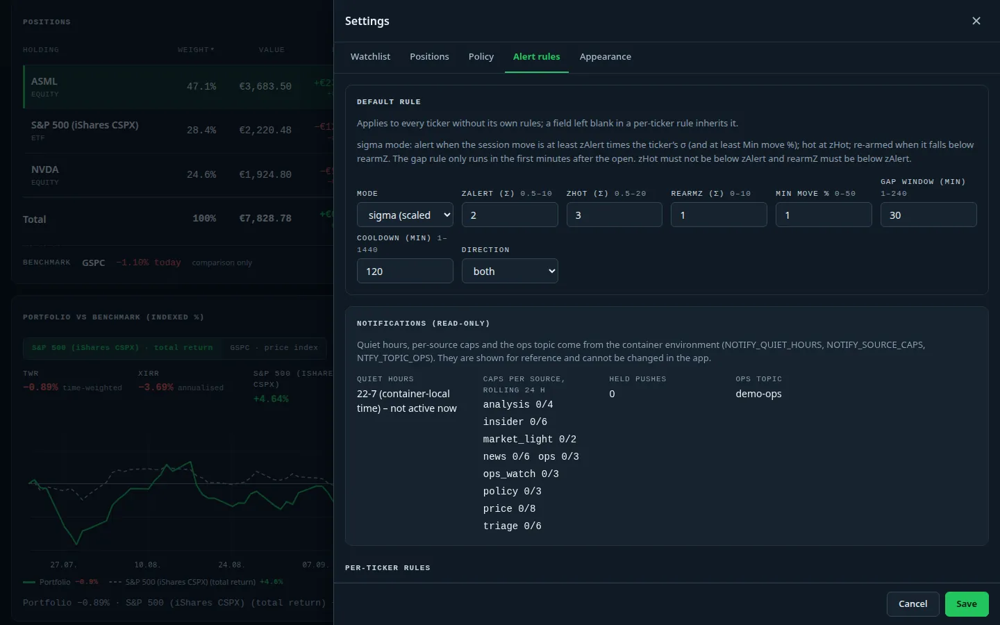

# Alerts and notifications

[← Documentation index](../README.md)

## Alert center

The bell in the header opens a drawer with every alert the dashboard has produced, newest first.

- Filters: **All / Urgent / Warn / Info** and **Unread only**; *Mark all read* or mark single alerts.
- Each card shows severity, ticker, time (absolute and relative), the *source* (`price`, `rule`,
  `rsi_threshold`, `digest`, `market_light`, …) and a short explanation with the numbers behind it.
- Unread state is kept server-side, so it is consistent across browsers and the badge count in the header
  always matches.

## Alert rules

*Settings → Alert rules* defines when alerts fire.

- **Default rule** (rules v3): the price-move **mode** (`sigma`, the default, or `pct`), `zAlert` (default 2.0),
  `zHot` (3.0), `rearmZ` (1.0), `minPct` (1.0 %), `gapWindowMin` (30), cooldown in minutes and direction;
  `thresholdPct` / `hotPct` are used only in `pct` mode. It applies to every ticker without its own rules; a blank
  field in a per-ticker rule inherits the default.
- **σ-scaled price alerts.** A move is divided by the ticker's own daily volatility σ (EWMA, λ = 0.94, over the last
  year of daily closes, today excluded), so a calm stock and a volatile one are not held to the same percent. A move
  alerts when `|z| >= zAlert` and the move is at least `minPct`; it is *hot* (priority 5) at `|z| >= zHot`. After an
  alert the same direction only alerts again at a higher whole `|z|` level or on reaching hot; the ladder re-arms when
  `|z|` falls below `rearmZ` or at the next session. The alert body shows the numbers, e.g. a line
  `ASML -5.0% vs prev close 1575.80 (z -2.1, σ 2.4%)` followed by `Alert at |z| >= 2 (min 1%).`. Without enough history the percent thresholds are used instead of
  staying silent. The current σ per ticker is served with the rules (`GET /api/alert-rules`).
- **Opening-gap rule.** The gap is the price against the previous close. It is checked only within `gapWindowMin` minutes
  after the venue's open, at most once per session per ticker, and never when the previous close is unknown. The previous
  close is the close of the *previous trading session of the listing's venue* (holidays and weekends skipped), so a gap
  is a real opening gap, not a currency artefact and not a comparison with a close two sessions old.
- **Per-ticker rules** (add with *+ rule*, switch a ticker's rules on/off with its checkbox): price move, absolute
  price level (above/below, optional one-shot and expiry date), RSI threshold, and further kinds such as EMA cross,
  volume spike, earnings lead time, short-ratio spike and market-light drop.
- **Older configs.** A v2 rules block is read as v3 (`mode: "sigma"`, new fields at their defaults); the stored block is
  not rewritten until you save from the UI.
- Every rule has a cooldown to avoid repeated pushes; the `rule_eval` worker reports pushed / degraded /
  skipped counts on [AI Ops](ai-ops.md).
- **Policy alerts.** When an `investmentPolicy` is configured (see [Settings](settings.md#portfolio-policy-and-tax)), a daily
  worker (18:00, only on days XETR or XAMS traded; `POLICY_WATCH_ENABLED`) pushes at priority 3 when a holding enters or
  leaves its band, when the single-stock cap is breached or cleared, when the monthly 10-month-average trend flips, and as a
  7-day reminder while a holding stays out of band.

## Push notifications

Alerts are delivered through [ntfy](https://ntfy.sh/) with a **durable outbox**: messages are queued on disk,
retried with back-off and de-duplicated, so a restart or a temporary network outage does not lose them. The
`notify_outbox` worker shows sent / pending / dropped counts. A minimum-severity filter is configurable
(`NOTIFY_MIN_SEVERITY`, see the [README](../../README.md#configuration)). Approval buttons in a push carry a
per-approval HMAC token.

- **Quiet hours** (`NOTIFY_QUIET_HOURS`, default `22-7`, container-local time): pushes created in the window are
  queued and sent when it ends. They are still stored in the alert center immediately. **Bypasses:** priority 5 pushes
  from the `price` and `policy` sources, and approval pushes. `off` disables the window. News alerts additionally keep
  their own quiet hours (00:00–07:00 by default, `newsMonitor` block).
- **Per-source caps** (`NOTIFY_SOURCE_CAPS`, rolling 24 h, persisted in `data/notify_caps.json`). Defaults:
  `ops_watch=3, ops=3, triage=6, news=6, analysis=4, price=8, insider=6, policy=3, market_light=2`. Over the cap nothing
  is pushed, but the alert is still stored in the alert center. Approval pushes are never capped. The current counts are
  shown under *Notification policy* on [AI Ops](ai-ops.md).
- **Ops topic.** Infrastructure alerts (GPU lane and host health from `ops_watch`, and the "digest did not run"
  notice) go to a separate ntfy topic, `NTFY_TOPIC_OPS` (default `<NTFY_TOPIC>-ops`, i.e. **`stocks-ops`**), at priority
  3 at most. **Subscribe the phone to `stocks-ops` if you want infra alerts**; they are no longer on the main topic.
  `ops_watch` repeats a persisting finding every 24 h (`OPS_WATCH_REALERT_S`) at priority 3, and writes a quiet
  "Resolved" row when it clears.
- **Deep links.** Every alert push carries a click target `<DASHBOARD_PUBLIC_URL or NTFY_CLICK_URL>#alerts/<id>`, which
  opens the alert center focused on that alert. Set one of the two variables to the URL your phone can reach.

In the demo instance ntfy is intentionally unreachable, so pushes sit in the outbox as *pending* – exactly
what the [AI Ops](ai-ops.md) screenshots show.
