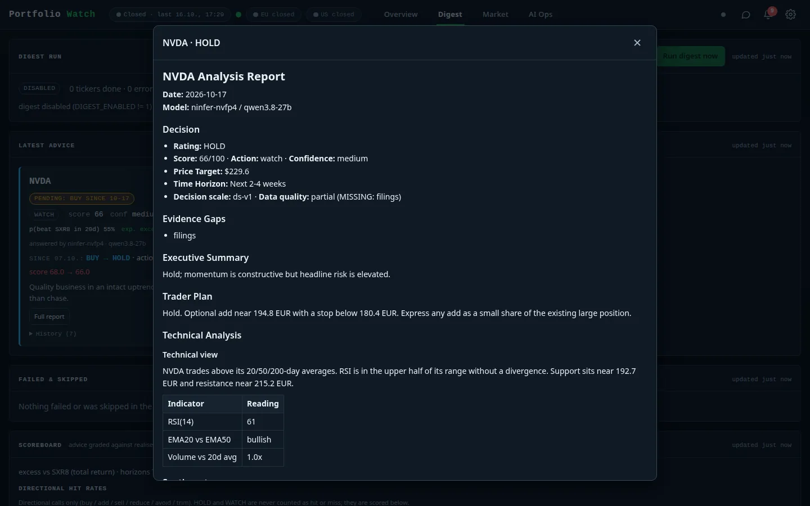

# AI analysis and reports

[← Documentation index](../README.md)

The analysis pipeline runs **in-process** on a local GPU lane (see [AI Ops](ai-ops.md)); no cloud LLM is used.
Roles: analysts → research debate → trader → risk → portfolio manager, producing a structured decision
(rating, action, score, confidence, price target, time horizon, plan, and two forecasts: `p_outperform_20d`, the probability
that the stock's EUR total return beats the performance benchmark over the next 20 trading days (clipped to 0.01–0.99, or
null), and `expected_excess_20d_pct`, the expected difference in percentage points). The forecasts feed the digest line and the
[scoreboard](digest-and-scoreboard.md#scoreboard). Analysis stages sample at `PIPELINE_TEMPERATURE` (default 0.2); the JSON
stages (portfolio manager, repair) at 0.1.

## Modes

| Mode | Research debate | Risk review | Notes |
|---|---|---|---|
| **Quick** | none | none | Cheapest; one pass from the analysts to the portfolio manager. |
| **Standard** | 1 round (bull + bear) | none | Default for the **Analyse** button. |
| **Deep** | 2 rounds | 1 rotation (aggressive → conservative → neutral) | If earnings fall inside the configured window, the *deep_earnings* playbook is used. |

The scheduled **digest** uses its own playbook (`digest`) so the consolidated push stays short and comparable. At a scheduled
slot it upgrades a ticker to a **deep** run when earnings are due, a new 8-K / 6-K appeared or triage flagged it (at most once a day).
Each mode costs LLM turns from a daily [budget](ai-ops.md) (default 30 per day, of which 16 are reserved for
the digest and 10 capped for triage).

Start an analysis from the holding detail with **Analyse**. Jobs appear in the *Analysis queue* on AI Ops with
status, mode, decision and a **Report** button.

## Evidence pack

Every analysis cites an **evidence pack**: each field carries `as_of` and `source`, or the literal `MISSING`.
The report lists the gaps (*Evidence gaps*, here "filings"). The pack can be inspected per ticker on
[AI Ops](ai-ops.md#evidence-pack). Besides identity, quote, technicals, news, filings, macro, fundamentals, short volume and
position, it carries:

- **`portfolio_context`**: how big the ticker is in the *whole* portfolio: every priced holding's weight, the ticker's direct
  and **look-through** weight (the fund share from `lookThrough` is added to the direct weight), currency exposure and the
  top-2 concentration. The playbooks tell the model to size every statement against it. Without configured look-through
  weights only direct weights are used.
- **`policy_context`**: the owner's `investmentPolicy` as it applies to this ticker (target, current weight, band status,
  single-stock cap, monthly trend state, where the next monthly contribution goes) and, for a Czech tax resident, whether a
  sale would be taxable and when the lots unlock. Numbers come only from this section; when it is `MISSING` the model must
  state no policy figure.
- **Foreign private issuers** (6-K / 20-F filers) have no Form 4 or 10-Q. Their insider and quarterly/TTM fields read
  `NOT_APPLICABLE (foreign private issuer)`, which is a statement, not a gap and not listed under *Evidence gaps*; their 6-K /
  20-F rows are filing metadata only. A symbol whose FINRA short volume is below the feed's floor reads `insufficient volume`,
  likewise not a gap.

## Report viewer

Reports open in a modal. Markdown is rendered through DOMPurify (the CSP forbids inline scripts and styles).
A report contains: decision header (rating, score, action, confidence, price target, horizon, decision-scale
version, data quality), evidence gaps, executive summary, trader plan with entry/stop levels, technical
analysis with an indicator table, and the supporting sections. Reports are addressed as `TICKER@date` and
stored under `results/<TICKER>/full_states_log_<date>.json`.

## Chat assistant

The chat panel streams answers from the active lane. It has **no tools and no internet**: each turn receives a
DATA block with current quotes, your position and the latest advice, and the model is instructed to answer only
from that block, quote the as-of time and say so when a price is stale or missing. The chat model is selectable
in *Settings → Appearance* (default: whichever lane is live).
