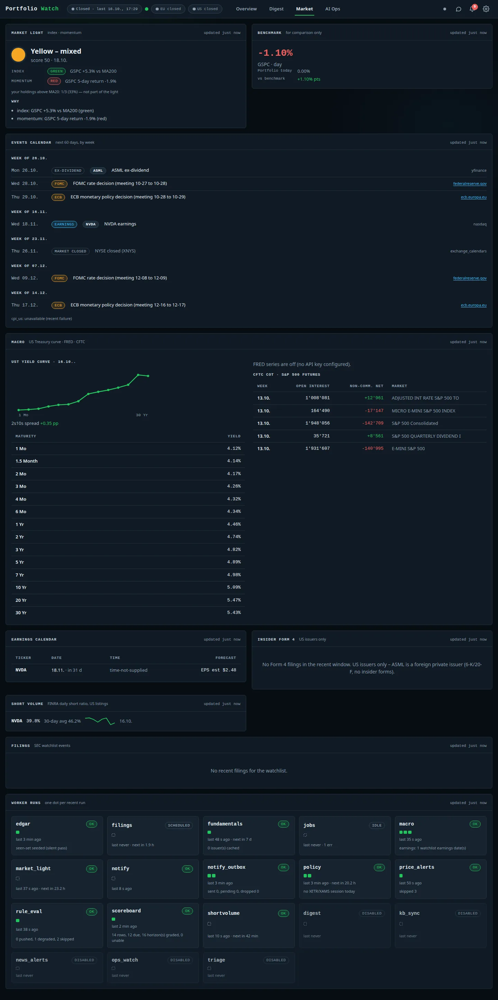

# Market view

[← Documentation index](../README.md)

All panels show an "updated … ago" stamp and degrade to an explicit empty state instead of hiding when a source
is off or has nothing to report.

| Panel | Content |
|---|---|
| **Market light** | Green / yellow / red regime with a score and the reasons from two dimensions: *index* (benchmark vs its MA200, with a ±2 % yellow band) and *momentum* (5-day benchmark return). A change to a worse colour raises an alert (priority 4). *Your holdings above MA20* (the former "breadth") is shown for information only: it never changes the colour, the score or the alert. With only one of the two dimensions available the light is marked `limited`. |
| **Benchmark** | Benchmark day move, portfolio day move and the difference. Comparison only – never an alert source. |
| **Macro** | US Treasury yield curve (table + curve, with the 2s10s spread) and CFTC Commitments-of-Traders positioning for S&P 500 futures. FRED series are optional (`FRED_API_KEY`); the panel says so when they are off. |
| **Earnings calendar** | Next earnings date, time and EPS estimate per watchlist ticker. |
| **Events calendar** | The next 60 days by week (`/api/events`): earnings (Nasdaq calendar), ex-dividend and dividend-pay dates (Yahoo), exchange closures (`market_closed`: weekday holidays of Amsterdam, Xetra and NYSE from the exchange calendars; early closes are not listed), FOMC and ECB meeting dates from tables transcribed from the official pages (each event links to its source; FOMC dates stay tentative until confirmed at the previous meeting) and US CPI release dates from FRED (needs `FRED_API_KEY`; omitted with a warning otherwise). A failing source shows a warning instead of hiding the rest. |
| **Insider (Form 4)** | SEC Form 4 filings for US issuers; foreign private issuers (6-K / 20-F filers) are explained rather than shown empty: the analysis evidence marks Form 4 and 10-Q data as `NOT_APPLICABLE (foreign private issuer)`, which is not a data gap. |
| **Short volume** | FINRA daily short-volume ratio with a 30-day average and sparkline, for US listings. |
| **Filings** | SEC watchlist events (8-K and similar). |
| **Worker runs** | One dot per recent run of each background worker, with last/next run and notes – the same data as [AI Ops](ai-ops.md), in compact form. |

Most panels are filled by background workers (`macro`, `edgar`, `filings`, `shortvolume`, `market_light`) that can
be switched on or off with the `*_ENABLED` variables (see the [README](../../README.md#configuration)).
