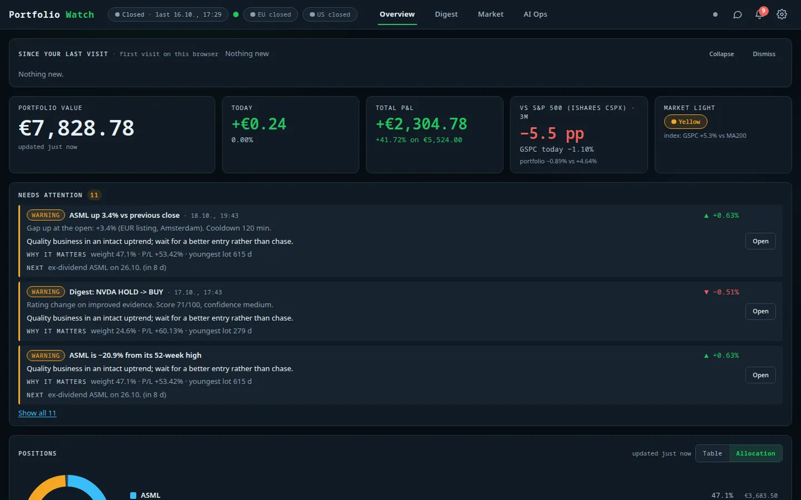
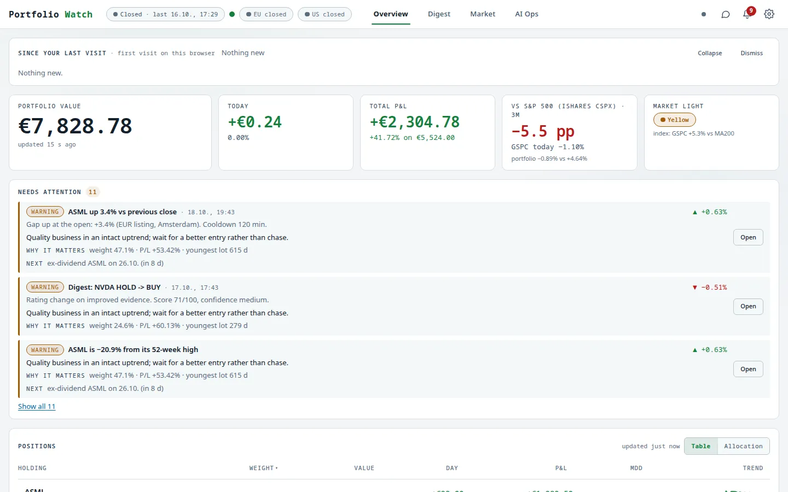

# Overview and positions

[← Documentation index](../README.md)

The **Overview** tab is the landing page: one glance tells you what the portfolio is worth, how today went,
how it compares with the benchmark, and what needs your attention.

*Demo data only: ASML, NVDA and an S&P 500 UCITS ETF with fictional share counts and cost bases.*

## Header

- **Session chips** – `Closed · last 16:25`, `EU closed`, `US closed`: venue-aware market hours, so a quiet
  price is not mistaken for a broken feed.
- **Tabs** – Overview, Digest, Market, AI Ops.
- **Status dot, chat, alert bell, settings** – the bell shows the unread alert count (see [Alerts](alerts.md));
  the speech-bubble opens the grounded chat assistant; the cog opens [Settings](settings.md).

## Hero stats

| Card | Meaning |
|---|---|
| **Portfolio value** | Σ shares × the EUR listing price. All amounts are EUR. |
| **Today** | Day P/L in EUR and percent. |
| **Total P&L** | Value minus the EUR cost basis. Positions *without* a known cost basis are valued but **excluded** from invested capital and P/L (and flagged), so P/L is never silently wrong. |
| **vs benchmark · 3M** | Percentage-point difference between the portfolio and the benchmark over the selected window. With a configured **performance benchmark** (for example the S&P 500 ETF, a total-return series) the comparison is against that; otherwise against the S&P 500 index converted to EUR. |
| **Market light** | Green / yellow / red regime from the index trend and momentum – details on the [Market](market.md) tab. The share of your holdings above their 20-day average is shown for information only and does not change the colour. |

## Needs attention

Open alerts and data-quality warnings, most important first (here: an RSI cross, an opening gap, and a
"no cost basis" notice for the ETF). **Open** jumps to the holding; **Show all** opens the alert center.

## Positions

- **Table** – weight, value, day P/L, total P/L, max drawdown (MDD) and a trend sparkline per holding, plus a
  total row and a benchmark row (shown for comparison only – it never produces alerts or analysis).
- **Allocation** – donut with the weight of each holding.
- Click a row to open the [holding detail](holding-detail.md) beside the table (a drawer on phones).
- A holding with an unknown cost basis shows `cost n/a` instead of a P/L.
- A `stale` chip appears on a row when its last quote is older than expected (market closed or feed lagging);
  a warning in *Needs attention* lists the affected holdings.

## Portfolio vs benchmark

An indexed chart (both series start at 0 %) over 1M / 3M / 6M / 1Y / **ALL**. The benchmarks are converted to EUR with
daily FX because the ETF listing is not currency-hedged, so the comparison is like-for-like. `ALL` starts at your first
dated lot; without dated lots it is limited to the last 5 years.

## Performance, attribution and risk

- **History basis.** With dated **lots** (Settings → Positions) the history uses the shares you actually held on each day and
  shows invested capital and a time-weighted-return line (`basis: lots`). Without lots it applies today's share counts to
  the whole window and says so with the warning *History applies today's share counts to the whole window*
  (`history_basis_current_shares`).
- **Return figures** (`/api/portfolio/performance`): **TWR** (time-weighted, flows-neutral), **XIRR** (annualised
  money-weighted return, only with dated lots for every holding), the performance benchmark's return over the same window and
  the **excess** in percentage points.
- **Attribution** (`/api/portfolio/attribution`): each holding's EUR return split into the local-currency return, the
  **FX** effect (against the holding's `exposureCurrency`, default its listing currency) and the cross term. A EUR-exposed
  holding has no FX effect.
- **Risk** (`/api/portfolio/risk`): direct exposure per holding, **look-through** exposure (a stock held directly *and* inside
  an index fund, using the fund weights you entered under `lookThrough`; the rows overlap, so they do not add up to 100 %),
  exposure by currency, 1Y volatility and beta against the performance benchmark, drawdown from peak and maximum drawdown
  (measured on the TWR index so a deposit is never a recovery), a correlation matrix and the top-2 concentration.
  Look-through weights older than 120 days are flagged.
- **Policy.** If an `investmentPolicy` is configured, the overview also flags holdings outside their band and single-stock
  cap breaches ([Settings](settings.md#portfolio-policy-and-tax)).

## Light theme

Theme choice (System / Light / Dark) is in *Settings → Appearance* and is stored in the browser only.
