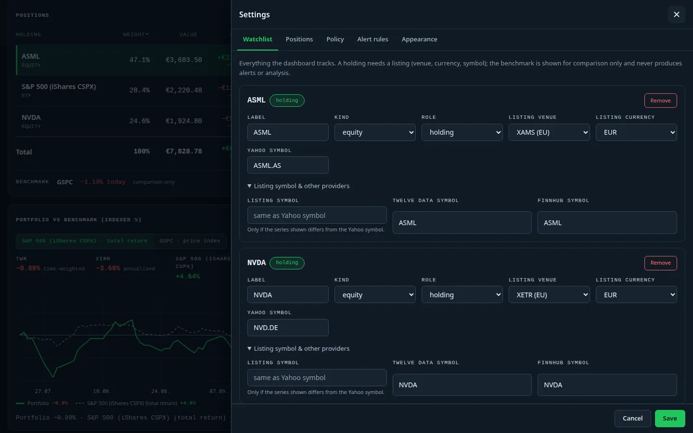
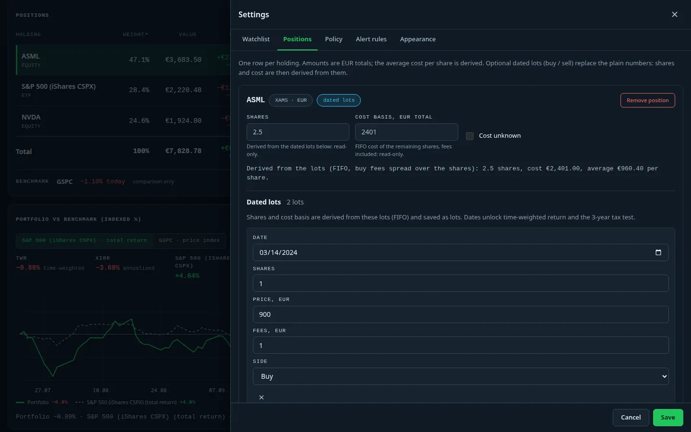
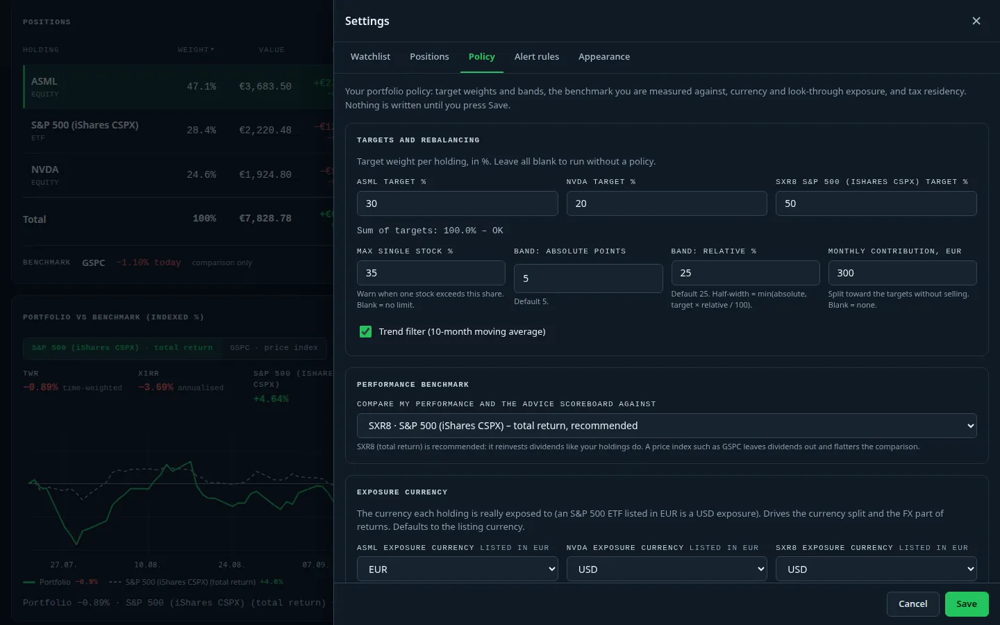

# Settings and configuration

[← Documentation index](../README.md)

*Settings* (cog in the header) edits the same `config/config.json` that you can also edit by hand. Saving writes
atomically and keeps a last-good copy, so a bad save cannot take the dashboard down.

## Watchlist



Everything the dashboard tracks. A holding needs a **listing** – venue, currency and symbol – because valuation,
charts and alerts all use the EUR listing. Per entry: label, kind (e.g. equity, etf, index), role (`holding`,
`benchmark`), listing venue and currency, the Yahoo symbol and – under *Listing symbol & other providers* – an
override for the listing symbol and the Twelve Data / Finnhub symbols. The **benchmark** is shown for comparison
only and never produces alerts or analysis.

## Positions



One row per holding: **shares** and **EUR cost basis (total paid)**. The average cost per share is derived.
Tick *Cost unknown* when you do not know it: the position is still valued but excluded from invested capital
and P/L, and the dashboard says so (see [Overview](overview.md)).

**Dated lots (optional).** Instead of one share count you can enter each purchase and sale as a lot: date, shares,
price in EUR, fees in EUR and side (buy / sell). Dates may not be in the future, a sale may not exceed the shares held on
its date, and lots are stored sorted by date. When a holding has lots the dashboard **derives** its share count and its
cost basis (the **FIFO** cost of the shares still held, buy fees included). The stored lots stay authoritative: a plain
save that changes the share count or cost of a holding with lots is rejected; edit the lots, or send an empty lot list to
drop them. Lots unlock the time-weighted and money-weighted (XIRR) returns, the exact history `basis`, the FX
attribution and the Czech tax view below. Positions without lots work exactly as before.

## Alert rules

Default rule plus per-ticker rules – see [Alerts and notifications](alerts.md#alert-rules). The price-move rule is
σ-scaled (`zAlert`, `zHot`, `rearmZ`, `minPct`, `gapWindowMin`); an older v2 block is read as v3 and kept until you save.

## Portfolio policy and tax

All of these are optional keys of `config/config.json` (validated on save; a bad value is rejected with a message):

```jsonc
"performanceBenchmark": "SXR8",
"exposureCurrency": { "NVDA": "USD", "SXR8": "USD" },
"lookThrough": { "SXR8": { "asOf": "2026-10-14", "source": "fund factsheet", "weights": { "NVDA": 7.6 } } },
"investmentPolicy": { "targets": { "ASML": 30, "NVDA": 20, "SXR8": 50 }, "maxSingleStockPct": 35,
                      "band": { "absPct": 5, "relPct": 25 }, "monthlyContributionEur": 300, "trendFilter": true },
"taxResidency": "CZ"
```

- **Performance benchmark** (`performanceBenchmark`): the watchlist entry you measure yourself and the advice scoreboard
  against. An accumulating ETF such as `SXR8` is a *total-return* series (it reinvests dividends); a price index such as
  `GSPC` leaves dividends out and flatters the comparison. Unset: the role benchmark.
- **Exposure currency** (`exposureCurrency`): the underlying currency of a holding (default: its listing currency), used
  for the FX attribution and the currency exposure.
- **Look-through** (`lookThrough`): for a fund, the percentage of it held in another watchlist entry, with the date and
  source of the numbers (you enter them; the dashboard does not fetch them). Weights per fund add up to at most 100.
- **Investment policy** (`investmentPolicy`):
  - `targets`: target weight per holding in %, adding up to 100 (± 0.5), holdings only.
  - **Bands** follow the 5/25 rule: the tolerance around a target is the smaller of `absPct` (5 percentage points) and
    `relPct` (25 %) of the target. A holding outside its band is *over* or *under*.
  - `maxSingleStockPct`: cap for any single **equity** (ETFs do not count).
  - `monthlyContributionEur`: the amount is **water-filled** toward the targets without selling anything, i.e. the most
    under-weight holdings are topped up first until the allocation reaches the targets.
  - `trendFilter`: a monthly trend flag per holding and for the benchmark, `above` or `below` its 10-month moving average
    of completed month-end closes.
  - A daily **policy worker** (`POLICY_WATCH_ENABLED`, default on) pushes band, cap and trend-flip edges; see
    [Alerts](alerts.md#alert-rules). The numbers are served by `/api/policy`.
- **Tax residency** (`taxResidency`, only `CZ` is implemented). For a Czech tax resident, securities held for **more than
  3 years** are exempt (the *time test*). From the dated lots (FIFO matching of sales to purchases) the dashboard shows each
  lot's **unlock date = purchase date + 3 years + 1 day**, whether it is exempt today, and the year-to-date **gross sale
  proceeds in CZK** (ECB EUR/CZK rate of each sale date, no fee deduction) against the **CZK 100,000** annual limit, with a
  warning from 80 %. The digest adds a tax note to a confirmed sell-family change. Served by `/api/tax`.
  **Caveat for your tax adviser:** whether sales of time-test-exempt lots count toward the CZK 100,000 limit is not decided
  by the dashboard. The headline figure conservatively counts *all* sales of the year; a second figure counts only sales of
  lots younger than 3 years. This is bookkeeping from your own lots, not tax advice.

## Appearance

Theme (System / Light / Dark, stored in the browser only), the chat model, and an *About* block.

## Where the data lives

| Item | Location | In Git? |
|---|---|---|
| Tickers, positions and lots, alert rules, policy, benchmark, tax residency | `config/config.json` (bind-mounted directory) | **No** (gitignored); `config/config.example.json` is a fictional sample |
| Credentials and feature flags | `env.secrets` (systemd `EnvironmentFile`) | **No** |
| Runtime state (advice, outcomes, notification outbox, `notify_caps.json`, `policy_state.json`) | `data/` | No |
| Analysis reports | `results/` | No |

`ops/deploy.sh` snapshots the config before a rebuild, refuses to deploy without a valid one and verifies it is
unchanged afterwards; `ops/restore-config.sh` restores it. Details in the
[README](../../README.md#run-build-deploy) and [`skills/ship-and-verify`](../../skills/ship-and-verify/SKILL.md).

## Policy



Target weights and rebalancing bands, the performance benchmark, per-holding exposure currency, ETF look-through
weights, the monthly contribution, the trend filter and tax residency. Nothing is written until you press Save.
Purchase lots (date, shares, price, fees) are entered per holding in the **Positions** tab; with lots the server
derives shares and cost basis, and the overview reports true time-weighted and money-weighted returns.
