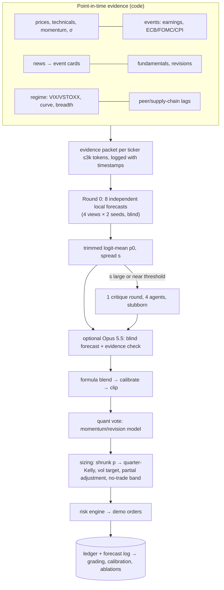

# Informed agents: research synthesis and design (2026-10-20)

Question from the owner: how do we define our agents and feed them enough information to forecast buy/sell decisions
as accurately as possible, using local LLM debates and optionally Claude Opus 5.5 as a final decision maker?

Detailed, cited reports (Sonnet 5.5 research agents, read and cross-checked by the orchestrator):
- [llm-trading-agents.md](llm-trading-agents.md) – TradingAgents, FinMem, FinAgent, FinCon, MarketSenseAI…, benchmarks, look-ahead bias
- [debate-and-calibration.md](debate-and-calibration.md) – multi-agent debate, aggregation, LLM forecasting, calibration
- [predictive-signals.md](predictive-signals.md) – which information predicts 1–20 day returns; EU data sources
- [decision-and-evaluation.md](decision-and-evaluation.md) – signal combination, sizing, turnover, skill vs luck, ablations
- [claude-integration.md](claude-integration.md) – calling Opus from the dashboard: subscription vs API key, terms, costs

## 1. What the evidence says (short)

1. **No published LLM trading agent has an edge that survived independent re-testing.** FINSABER re-ran FinMem/FinAgent
   over 20 years × 100+ symbols with costs: no significant alpha, buy-and-hold won. A TradingAgents reproduction halved
   its Sharpe after costs. Live / post-training-cutoff tests are mostly null or negative.
2. **Backtests of LLMs on data inside their training period are contaminated** (models recall prices and macro figures;
   matched pre/post-cutoff runs lost 50–72 % of their returns). Only live, post-cutoff runs count – which is what our
   demo setup does.
3. **Debate adds little by itself.** Most measured gains come from *independent* samples + good aggregation +
   calibration + evidence quality. Majority/mean of independent answers beat debate on average; more than ~2 rounds
   lowers accuracy; sycophancy (agents abandoning correct answers) is the main failure – documented at the 27–70B scale.
   An LLM "judge" that reads forecasts and writes a number did *worse* than the plain mean.
4. **A frontier model helps most as an independent member and evidence checker,** not as the judge: a blind forecast
   from the same evidence, plus a pass that lists contradicted/missing facts. The final number comes from a formula.
5. **Information with documented short-horizon value** (mostly US, mostly decayed after publication): LLM news sentiment
   (1–2 day drift, pre-cost, shrinking fast), post-earnings drift, analyst revisions, 12-1 momentum, insider *purchases*,
   volatility regime (for sizing, not picking), peer/supply-chain links. No free single signal shows a net-of-cost edge
   on EU large caps.
6. **Costs and turnover decide viability.** Trading straight to targets daily loses ~45 % of a small edge at 5 bp;
   partial adjustment toward targets plus no-trade bands recovers most of it. Signals that decay within a day are
   untradeable at our costs → the hourly intraday bucket is expected to lose; it stays as a measured control.
7. **Skill vs luck needs time.** At a realistic information ratio of 0.3–1.0, six months gives 8–17 % power to detect
   skill. Judge the process monthly (calibration, Brier skill, costs, turnover), not P&L. A realistic target is
   *match buy-and-hold net of costs with lower drawdown*; the evidence does not support expecting alpha.

## 2. Design: "independent-first, debate-gated, formula-aggregated, calibration-last"

**Roles**
| Role | Model | Output | When |
|---|---|---|---|
| News/event analyst | local, fast settings | event card {ticker, type, direction, magnitude, novelty, horizon, confidence, source, time} | per relevant article (after keyword/relevance filter) |
| Regime analyst | local | risk-on / neutral / risk-off + confidence | once per day |
| View forecasters (fundamental, event/news, technical/flow, base-rate contrarian) | local, 2 seeds each, blind | reference class → base rate → for/against → crux → p(outperform 5d/20d) | per ticker, daily |
| Critics | local, "stubborn" | revised p only on a new fact from the packet (|Δlogit| ≤ 0.5) | only when spread is large or p is near the action threshold |
| Opus 5.5 (optional) | frontier | (a) blind p from the packet, (b) list of contradicted/missing facts | gated runs or weekly per name |
| Aggregator / sizing | **code** | blended, calibrated p; target weights | every decision |
| Quant model | **code** | momentum / revision-adjusted reversal score | every decision |

**Budget (local, from the debate report; decode speed unverified):** ~7–10k output tokens per ticker-decision,
~75–100 s sequential (~25–40 s batched). 3 names daily ≈ 5 min of GPU; 10 names ≈ 15 min. That needs its own budget
purpose (e.g. `forecast`, ~40 calls/day), far above today's 3 turns – an owner decision because the lane is shared.

## 3. Information roadmap (value per effort)
1. **Point-in-time logger** for every input (news, estimates, VIX/VSTOXX, registers) – foundation for honest evaluation.
2. **Event cards** replacing raw headlines; ≥2 independent source domains per item (poisoning guard).
3. **Volatility/regime features** (VIX via FRED, VSTOXX if obtainable, ECB rates) for sizing and abstention.
4. **Earnings-calendar conditioning** (days to earnings, post-announcement window, surprise vs consensus).
5. **12-1 momentum and 1-week reversal** as base-rate priors (free from prices we have).
6. **Peer/supply-chain map** (ASML ↔ TSMC/Samsung/Intel capex, NVDA ↔ hyperscaler capex, SOX) with lagged returns.
7. **GDELT news volume/tone** as attention features.
8. Later, only if the ablations show the pipeline uses information: insider-purchase registers (AFM/BaFin), paid
   transcripts (~$99/month).

## 4. Decision and evaluation rules to adopt
- Probabilities shrunk toward the base rate (κ₀ = 0.3) until ~1,000 graded events; then logistic recalibration.
- Size: μ = σ·Φ⁻¹(p), quarter-Kelly, per-name cap, 10 % volatility target; partial adjustment 15 % per day toward
  targets; no-trade band; cost 7 bp one-way (stress 15 bp) on every paper fill.
- Evaluation: net active return vs owner's buy-and-hold; Brier skill score, calibration (ECE), IC, probabilistic and
  deflated Sharpe with a **trial ledger** (every prompt/model/threshold change counted); results by market regime.
- Ablations: a **shadow universe** of ≥30 liquid EU names scored on forecasts only (no orders) to get enough events;
  paired replays with one input removed; Holm correction over ≤6 comparisons.

## 5. Opus 5.5 integration
- **Recommended: an Anthropic API key** (dedicated workspace, $20–30/month spend limit). Estimated $0.12–0.35 per Opus
  decision → about $3–21/month at 1–3 decisions per trading day.
- **Subscription (`claude setup-token` + Agent SDK / `claude -p`) works technically, but the Consumer Terms as fetched
  ban automated access except via API key (§3(7)) and relying on the service to buy/sell securities (§3(9)).** The
  saving is a few dollars a month, so the terms risk is not worth it. If used anyway: no tools, empty working
  directory, token in a 0600 secret, `ANTHROPIC_API_KEY` unset in that process.
- Opus never sees raw untrusted text without the DATA framing; it never places orders; failures degrade to the local
  aggregate, then to hold. Every decision is tagged with its source.

## 6. Proposed phases
| Phase | Content | Needs owner |
|---|---|---|
| 6a | Point-in-time logger; forecast log; trial ledger; Brier/ECE/IC per forecaster | – |
| 6b | Event cards + regime analyst + momentum/reversal/vol features in the packet | – |
| 6c | Independent-first forecaster pool (N=8), formula aggregation, gated critique, calibration-by-shrinkage, sizing rules | GPU budget (~40 calls/day) |
| 6d | Shadow universe (≥30 EU names, forecasts only) for ablations | GPU budget |
| 6e | Opus 5.5 blind forecaster + evidence checker | API key (or subscription decision) |
| 6f | Peer/supply-chain map, GDELT attention, earnings conditioning | – |
| 6g | Paid data only if ablations show value | money |
